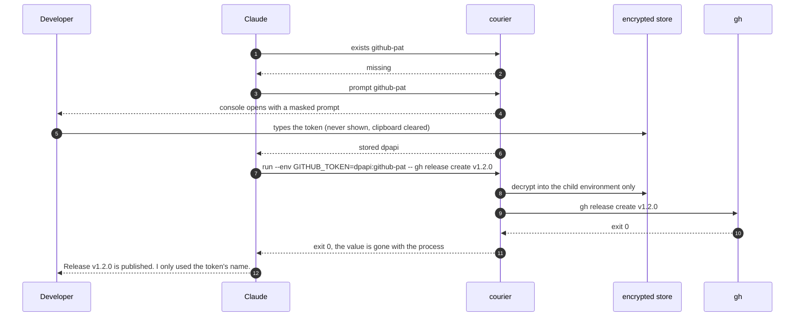
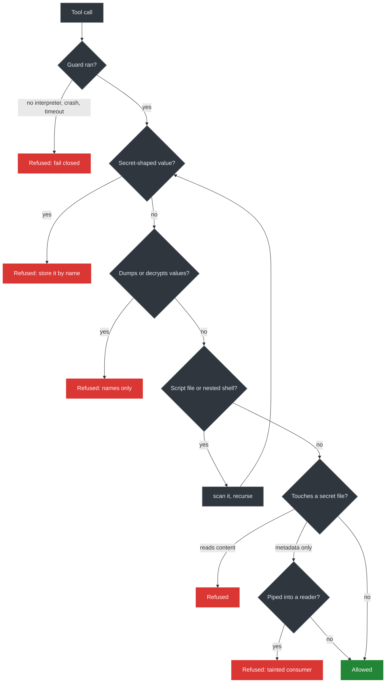
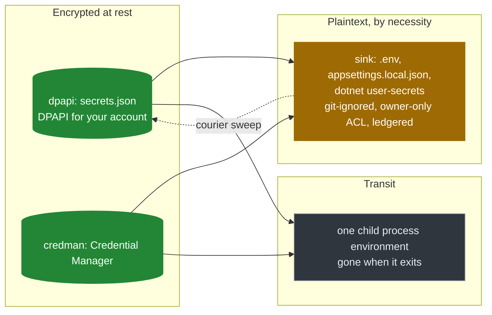

# secret-courier

[](https://github.com/rankinbc/secret-courier/actions/workflows/ci.yml)
[](https://github.com/rankinbc/secret-courier/releases)
[](LICENSE)


**Let Claude Code use your API keys, tokens and passwords without ever seeing them.**

secret-courier moves secrets **by name**. You type a value once, at a masked prompt, into an encrypted store.
From then on Claude asks for `github-pat`, never for the token: the plugin delivers it straight into the
process that needs it, into a git-ignored config file, or into an HTTPS health check, and reports back one
sentence about where the value went. Every plaintext copy it ever makes is on a ledger you can sweep.
Guard hooks keep Claude's own tools away from secret files and value-printing commands, and they fail closed.

```
> /courier run --env GITHUB_TOKEN=dpapi:github-pat -- gh release create v1.2.0

Ran gh with GITHUB_TOKEN set in its environment only. The process has exited with code 0 and the
value is gone with it. Nothing was written to disk.
exit 0
```

## Why

- **The agent does real work now.** Wiring an API client, publishing a release, running a migration: every one
  of those needs a credential, and the easy paths (paste it in chat, write it to a file, export it) all leave
  the value where a model, a transcript or a later command can read it.
- **Names are enough.** A model can do everything it needs with `github-pat` as a handle. It never needs the
  40 characters behind it.
- **"Nothing left lying around" should be checkable.** Secrets end up in `.env` files, shell histories and
  log lines because nobody tracks the copies. secret-courier records each one and removes them on request.

## How it keeps a secret safe

1. **Entry at a masked prompt, into an encrypted store.** `courier prompt github-pat` opens a console window
   on your machine. The value is read as a `SecureString`, DPAPI-encrypted for your Windows account into
   `~/.secret-courier/secrets.json` (or stored in Windows Credential Manager), and the clipboard is cleared
   if it still holds the value. The store directory carries an owner-only ACL with every stray ACE stripped,
   including the logon-session SID Windows copies from the creating token.
2. **Only names cross the model boundary.** Every command Claude runs takes `<store>:<name>` arguments; the
   bridge validates each one as a name before any script starts. Each operation prints exactly one
   `STATUS` line and a sentence of explanation, never a value. The bridge redacts the output anyway, and if
   anything secret-shaped survives, the whole result becomes an error.
3. **Delivery without exposure.** `run` puts the value in one child process environment and nothing else.
   `inject` writes a plaintext config file only where git ignores it, with an owner-only ACL, and records
   the path, keys and an id in the ledger. `test` sends one HTTPS request through `HttpClient` with the
   value in a header. In every path the value is a `SecureString` until the .NET call that needs it; no
   value is ever passed to a PowerShell cmdlet as a parameter, because host policy can log those.
4. **Guard hooks that fail closed.** Before every `Bash`, `PowerShell`, `Read`, `Grep`, `Glob`, `Write`,
   `Edit` and `NotebookEdit` call, a standard-library Python guard checks the request. It refuses reads of
   secret files, commands that dump or decrypt values, secret-shaped values in commands or written files,
   and scripts or nested shells that would do any of those. If the guard cannot start, crashes or times
   out, the call is refused.
5. **A ledger, and a sweep.** `courier sinks` lists every plaintext copy the plugin wrote. `courier sweep`
   removes the keys it wrote and deletes a file left empty. The encrypted stores are never touched by it.

## How it moves a secret


| Command | What it does | What Claude gets back |
|---|---|---|
| `courier prompt github-pat --description "GitHub PAT for releases"` | Opens a masked prompt; encrypts the value into the store | `stored dpapi` and where it lives |
| `courier exists github-pat` | Says which store holds the name | `found credman` and how it is protected |
| `courier run --env GITHUB_TOKEN=dpapi:github-pat -- gh release list` | Runs a command with the value in its environment only | `exit 0`, "the value is gone with it" |
| `courier inject --target .env --format dotenv --map GITHUB_TOKEN=dpapi:github-pat` | Writes a git-ignored, ACL'd config file and ledgers it | the ledger id and the `sweep` command |
| `courier test github-pat github` | One HTTPS GET with the value in the header | `valid 200` or `invalid 401` |
| `courier copy dpapi:github-pat credman:github-pat` | Moves a value between stores in memory | `stored credman` |
| `courier sinks` / `courier sweep` | Lists and removes plaintext copies | what was removed |
| `courier names` / `courier log` / `courier doctor` | Inventory, audit trail, health | names and statuses only |

Stores: `dpapi` (encrypted file, the default), `credman` (Windows Credential Manager), and two read-only
sources, `env` (the current environment) and `keyvault:<vault>/<secret>` (Azure Key Vault under your own
`az login`, interactive only). Sources are never destinations: an exported variable or a vault is not a
place this plugin writes to.

## A session, end to end

Claude is asked to publish a release and needs a GitHub token. Nothing in this exchange is a value.



What the developer sees in the console at step 4:

```
secret-courier: a value is needed for 'github-pat'
  What it is for: GitHub PAT for releases

  Where it goes: the DPAPI file store (C:\Users\brian\.secret-courier\secrets.json), encrypted for the
  Windows account brian; only code running as you can decrypt it.
  What Claude sees: only the name 'github-pat' and the word 'stored'. This window is the only place the
  value exists in clear, and it shows nothing while you type.
  Nothing leaves this machine. If you paste, the clipboard is cleared afterwards.

Type or paste the value and press Enter. Press Enter on an empty line to cancel.
github-pat: ****************************************
Stored 'github-pat'. Nothing else was written. You can close this window and tell Claude to continue.
```

## What the guard refuses



- **Secret-shaped values**: JWTs, personal access tokens, cloud keys, private key blocks, `Authorization`
  headers, `NAME_PASSWORD=...` assignments, in a command, a prompt, or a file being written.
- **Dumps and decrypts**: `printenv`, `process.env`, `ConvertFrom-SecureString`, `keyring get`, `cmdkey`,
  `az keyvault secret show`, `az ... keys list`, `aws secretsmanager get-secret-value`, `gcloud secrets
  versions access`, `vault kv get`, `op read`, `gh auth token`, `kubectl get secret -o`, references to
  credential-named variables, git config and remote dumps, encoded PowerShell commands however nested.
- **Secret files**: `.env*`, `secrets.json`, `appsettings.local.json`, `local.settings.json`, key and
  certificate files, `.netrc`, `.pgpass`, `terraform.tfvars`, `~/.ssh`, `~/.aws`, `~/.azure`, `~/.kube`,
  `~/.secret-courier`, including backups, 8.3 short names, symlinks, globs (`cat .en?`, `*.{pem,key}`) and
  listings fed into a reader (`cat $(ls .env)`, `ls .env | xargs cat`).

A refusal tells the agent what to do instead:

```
Blocked: that command reads a secret-bearing file, and Claude handles secret NAMES only. Instead:
`courier exists <name>` says where a value is held; `courier run --env VAR=<store>:<name> -- <command>`
gives a program the value without printing it (secret-courier).
```

## Where a value can exist

Every place a value may live is enumerable, which is what turns "nothing left lying around" from a hope into
a check.



| Kind | Protection | Find it | Remove it |
|---|---|---|---|
| `dpapi` store | DPAPI for the current user; owner-only ACL | `courier names` | `courier remove dpapi:NAME` |
| `credman` store | the OS credential vault, current user | `courier names` | `courier remove credman:NAME` |
| sink (plaintext file) | refused unless git ignores it; owner-only ACL; on the ledger | `courier sinks` | `courier sweep` |
| transit (child environment) | nothing written anywhere | nothing to find | nothing to remove |

## Trust, verified

- **Fail closed, proven on the machine.** `courier doctor` runs a copy of the guard wrapper with an empty
  `PATH` and checks that it refuses the call. A hook that cannot start, crashes or times out blocks
  (`"onFailure": "block"`), never passes.
- **No dependencies in the hook path.** The guard is standard-library Python, launched by a `.cmd` wrapper
  that finds any Python 3.11+. No virtual environment, no pip, nothing to build on install. A test diffs
  `sys.modules` to keep it that way.
- **The repository cannot hold a secret.** Test fixtures build secret-shaped strings at runtime, and CI runs
  `courier scan . --fail-on-findings` against the repository itself on every push.
- **Tests that never touch the network.** 156 pytest cases and 17 Pester cases run on `windows-latest` for
  Python 3.11 and 3.13. Key Vault and cloud paths are asserted to refuse before anything is called.
- **An add-only policy.** Every deny list is one JSON file. A developer overlay can add entries and choose
  the paste policy; it cannot remove or weaken a rule, and `doctor` reports anything it ignored.
- **Honest limits, written down.** `SECURITY.md` states what a text-level guard cannot see (a path assembled
  inside an interpreter), what a blocked prompt still leaves in the session transcript on disk, and what
  DPAPI does and does not protect against.

## Install

Windows 10/11, PowerShell 7, Python 3.11+, Claude Code 2.1.295 or newer.

```
claude plugin marketplace add rankinbc/secret-courier
claude plugin install secret-courier@secret-courier
```

Restart Claude Code. Installing registers the guard hooks, the paste hook, the `/courier` command and the
`secret-courier` skill. The first line of the next session confirms it:

```
secret-courier 0.1.0: guard hooks active (Python 3.13, paste policy advise).
```

`/courier doctor` checks every probe:

```
[OK] python - 3.13.14, secret-courier 0.1.0
[OK] pwsh - C:\Program Files\PowerShell\7\pwsh.EXE
[OK] hooks - 3 tool guards block on failure, paste hook wired, paste policy advise
[OK] guard fail-closed - no interpreter -> exit 2, the tool call is refused
[OK] policy - 27 file families, 41 value-dump tokens, paste advise
[OK] home - C:\Users\brian\.secret-courier not created yet (the first `courier prompt` creates it)
Healthy
```

Nothing is written to your machine until the first `courier prompt` creates `~/.secret-courier`.

## Configure

`~/.secret-courier/guard-policy.json` adds to the deny lists and sets the paste policy (`advise` injects an
interceptor instruction; `block` refuses the message):

```json
{ "denied_dirs": ["my-vault-dir"], "paste": "block" }
```

`~/.secret-courier/config.json` adds endpoints `courier test` may probe (ids reach the model, URLs do not):

```json
{ "endpoints": { "my-api": { "url": "https://api.example.com/me", "auth": "bearer", "expect": 200 } } }
```

`COURIER_HOME` moves the state directory. `COURIER_PYTHON` pins the interpreter the hooks use.

## Inside

| Part | Role |
|---|---|
| `hooks/hooks.json`, `scripts/courier-guard.cmd`, `scripts/courier_entry.py` | the hook wiring and the fail-closed launcher |
| `src/courier/guard*.py`, `policy.py`, `patterns.py`, `scan.py` | the guard and the detector; standard library only |
| `src/courier/bridge.py`, `cli.py`, `doctor.py`, `session.py` | the model-facing surface: validates names, runs ops, redacts |
| `powershell/Courier.psm1`, `CourierSinks.psm1` | the only code that touches a value: stores, ACLs, the interactive guard, the ledger, the audit log |
| `powershell/ops/*.ps1` | one script per operation; one `STATUS` line each |
| `config/guard-policy.json`, `config/endpoints.json` | the deny lists and the endpoint catalogue |
| `skills/secret-courier/SKILL.md`, `commands/courier.md` | how Claude decides what to run, and `/courier` |

```
python -m pip install -e ".[dev]"
python -m ruff check src tests scripts && python -m ruff format --check src tests scripts
python -m pytest -q
pwsh -NoProfile -Command "Invoke-Pester -Path powershell/tests"
courier doctor
```

See `CONTRIBUTING.md` for the rules that keep the plugin trustworthy, `SECURITY.md` for the contract and its
limits, and `CHANGELOG.md` for releases.

## Roadmap

A keychain backend and a shell wrapper for macOS and Linux. A Key Vault round trip under test against a real
vault. `courier rotate`: re-prompt once and re-inject every sink that holds the name.

MIT license.
