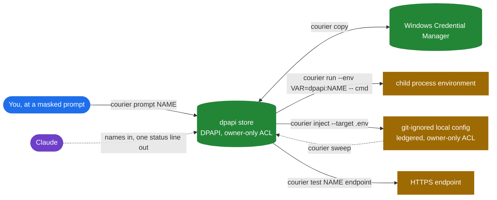
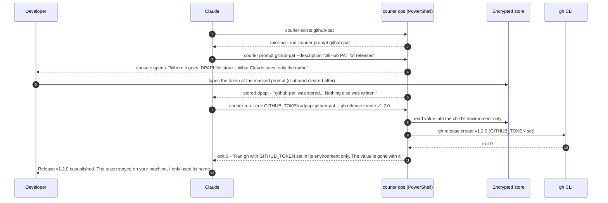
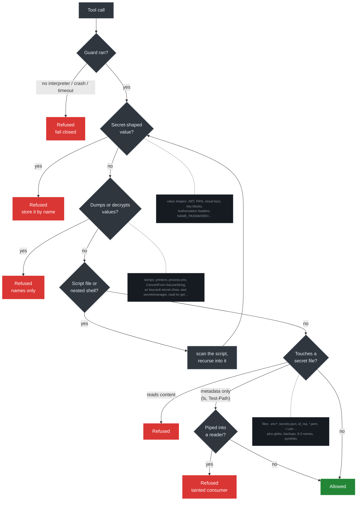
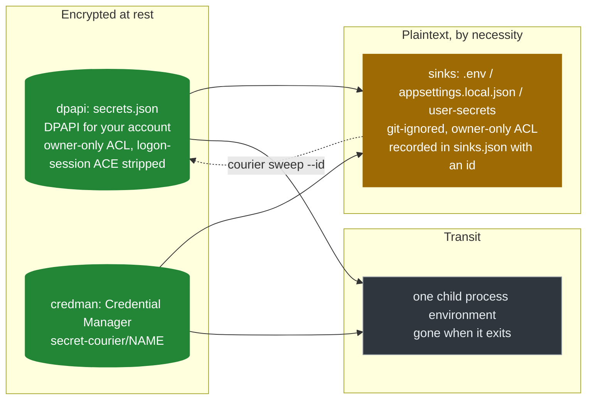
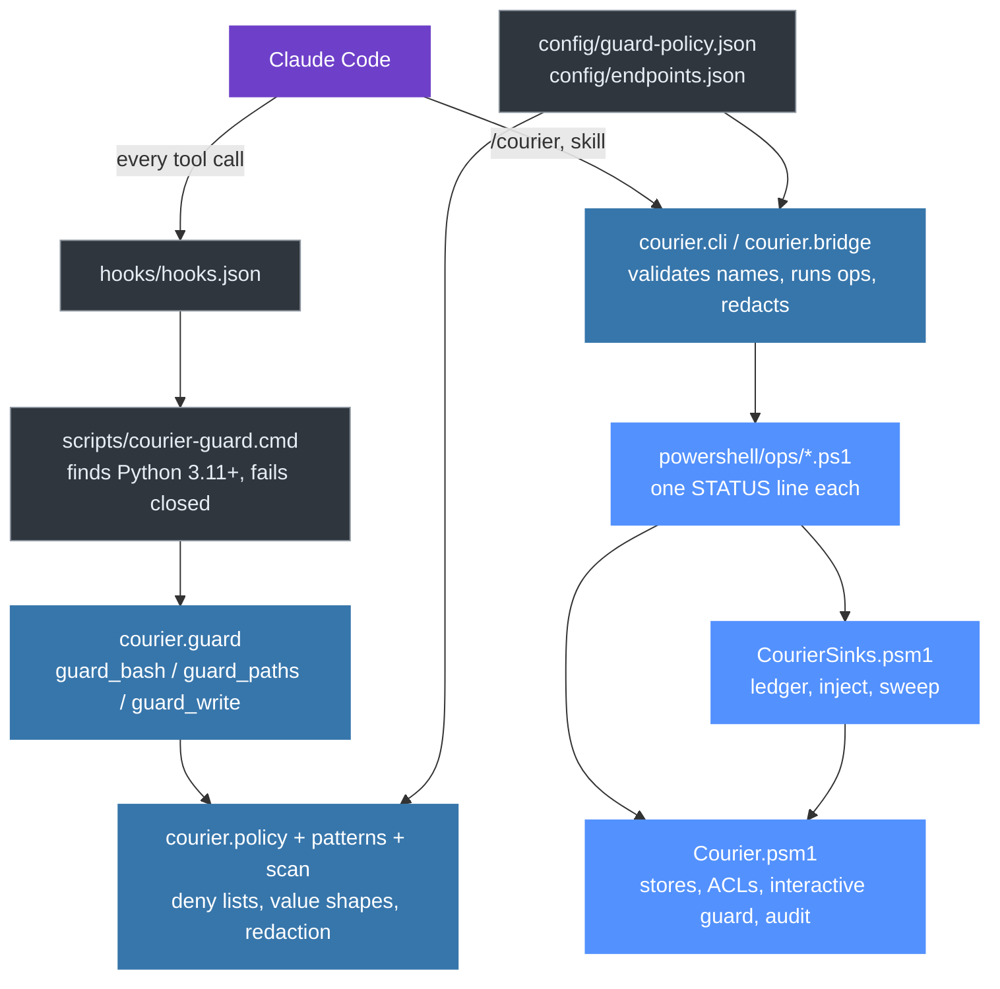

# secret-courier

[](https://github.com/rankinbc/secret-courier/actions/workflows/ci.yml)
[](https://github.com/rankinbc/secret-courier/releases)
[](LICENSE)


**A Claude Code plugin that lets an AI coding agent use your secrets without ever seeing them.**

Secrets move **by name**. The value goes from your keyboard into an encrypted store once, and from there
to wherever a job needs it: a child process, a git-ignored `.env`, an HTTPS probe. The model gets back one
sentence saying what happened and where the value is now. Every plaintext copy the plugin makes is recorded
in a ledger and can be swept with one command. Hooks keep the agent's own tools away from secret files and
value-printing commands, and they **fail closed**.

```
> /courier exists github-pat
'github-pat' is held in Windows Credential Manager as 'secret-courier/github-pat', encrypted by the OS
for the account brian. Its value was not read for this check.
found credman
```

---

## The problem

AI coding agents are now good enough to wire up an API client, write a deploy script, or set up a local
environment end to end. Each of those jobs needs a token. Today that token tends to end up in one of three
places: pasted into the chat (now in the transcript, the provider's logs and the model's context), written into
a config file the agent can read back later, or exported into an environment the agent can dump with one
command. None of that is a model misbehaving. It is the absence of a safe path.

secret-courier is that path. It gives the agent a vocabulary of **names** and a set of **operations** that move
values around on its behalf, plus **guard rails** that make the unsafe paths fail.

## What it does



| You want | You (or Claude) run | What happens |
|---|---|---|
| Give the agent a token without showing it | `courier prompt github-pat` | A console opens with a masked prompt. The value is DPAPI-encrypted into `~/.secret-courier/secrets.json` (or Credential Manager). Claude learns the name and the word `stored`. |
| Run something that needs the token | `courier run --env GITHUB_TOKEN=dpapi:github-pat -- gh release list` | The value exists only in that child process. When it exits, the value is gone. |
| Put it where an app reads its config | `courier inject --target .env --format dotenv --map GITHUB_TOKEN=dpapi:github-pat` | Refused unless git ignores the file. Written with an owner-only ACL and recorded in a ledger with an id. |
| Check a token still works | `courier test github-pat github` | One HTTPS GET through `HttpClient` with the value in the header; reports `valid 200` or `invalid 401`. The URL comes from config, never from the model. |
| Clean up afterwards | `courier sinks` then `courier sweep` | Lists every plaintext copy the plugin wrote; removes the keys it wrote (and a file left empty). |
| Know what happened | `courier log` | The audit trail: time, operation, status. Names only. |

## A session, end to end

A developer asks Claude to publish a release. Claude needs a GitHub token. Here is the whole exchange with the
plugin installed. Nothing in it is a value.



What the developer sees in the console that opens at step 4:

```
secret-courier: a value is needed for 'github-pat'
  What it is for: GitHub PAT for releases

  Where it goes: the DPAPI file store (C:\Users\brian\.secret-courier\secrets.json), encrypted for the
  Windows account brian; only code running as you can decrypt it.
  What Claude sees: only the name 'github-pat' and the word 'stored'. This window is the only place the
  value exists in clear, and it shows nothing while you type.
  Nothing leaves this machine. If you paste, the clipboard is cleared afterwards.

Type or paste the value and press Enter. Press Enter on an empty line to cancel.
github-pat: ****************************************
Stored 'github-pat'. Nothing else was written. You can close this window and tell Claude to continue.
```

## The guard rails

The plugin registers PreToolUse hooks for every Claude Code tool that can read or run something: `Bash`,
`PowerShell`, `Read`, `Grep`, `Glob`, `Write`, `Edit`, `NotebookEdit`, plus a hook on every prompt. The hook is a
standard-library Python program launched by a `.cmd` wrapper; no virtual environment, no pip, nothing to
build. Any failure refuses the call.



Refusals tell the agent what to do instead:

```
Blocked: that command reads a secret-bearing file, and Claude handles secret NAMES only. Instead:
`courier exists <name>` says where a value is held; `courier run --env VAR=<store>:<name> -- <command>`
gives a program the value without printing it (secret-courier).
```

What the Bash guard closes that a naive denylist misses: `cat $(ls .env)`, `ls .env | xargs cat`, `cat .en?`,
`type secret*.json`, `bash -c "cat .env"`, `cmd /c powershell -EncodedCommand ...`, `node -e
"console.log(process.env)"`, `pwsh -File temp.ps1` where the script reads the store, and a `Write` of that
script in the first place. What it cannot see, and says so: a path assembled inside an interpreter
(`'.e'+'nv'`). The Read and Write hooks and the OS ACL on the store are the floor beneath it.

## Where a value can exist

Every place a value may live is enumerable, which is what makes "nothing left lying around" a checkable claim
rather than a hope.



| Kind | Protection | How you find it | How you remove it |
|---|---|---|---|
| `dpapi` store | Windows DPAPI for the current user; owner-only ACL with every stray ACE stripped | `courier names` | `courier remove dpapi:NAME` |
| `credman` store | the OS credential vault, current user | `courier names` | `courier remove credman:NAME` |
| sink (plaintext file) | refused unless git ignores it; owner-only ACL; ledgered | `courier sinks` | `courier sweep` |
| transit (child env) | nothing written anywhere | nothing to find | nothing to remove |

Sources that are never destinations: `env:` (an exported variable would be readable by any later command) and
`keyvault:` (a network read under your own `az login`, interactive only).

## Engineering decisions worth a look

- **Fail closed, not open.** A hook that cannot start, times out, or crashes refuses the tool call
  (`"onFailure": "block"` plus a wrapper that exits 2 on every path but success). `courier doctor` proves it
  on the machine by running a copy of the wrapper with an empty `PATH`.
- **Standard library only in the hook path.** Hooks run on every tool call; a venv build, a pip install or a
  lock file in that path is a latency and a failure mode. The guard chain is ~1,300 lines of Python with no
  third-party import, enforced by a test that diffs `sys.modules`.
- **Values never pass through a cmdlet parameter.** Where Windows policy turns on PowerShell module logging,
  cmdlet parameter values land in the event log. So the ops carry values as `SecureString` and hand them to
  `.NET` directly: `[IO.File]`, `HttpClient`, P/Invoke `CredWrite`. The one plaintext string exists for the
  call that needs it and is nulled after.
- **The bridge trusts nothing it is handed.** Every argument is validated as a name or `store:name` before any
  script runs. The script's output is redacted anyway, and anything secret-shaped in it turns the whole result
  into an error. A buggy op cannot leak through the bridge.
- **One policy file, add-only overlay.** Every deny list lives in `config/guard-policy.json`. A developer's
  overlay can add entries and set the paste policy; it cannot remove or weaken anything, and `doctor` reports
  what it ignored.
- **The repo cannot hold a secret.** Test fixtures build secret-shaped strings at runtime; CI runs
  `courier scan . --fail-on-findings` against the repository itself.
- **Honest limits, written down.** `SECURITY.md` lists what a text-level guard cannot see, what a blocked
  prompt still leaves on disk, and what DPAPI does and does not protect against.

## Architecture



| Part | Lines | Role |
|---|---|---|
| `src/courier/guard*.py`, `policy.py`, `patterns.py`, `scan.py` | ~1,300 | the hooks and the detector; stdlib only |
| `src/courier/bridge.py`, `cli.py`, `doctor.py`, `session.py` | ~750 | the model-facing surface |
| `powershell/Courier.psm1`, `CourierSinks.psm1` | ~550 | the only code that touches a value |
| `powershell/ops/*.ps1` | ~260 | one script per operation |
| `tests/`, `powershell/tests/` | 156 pytest + 17 Pester | fixtures built at runtime; no live cloud calls |

## Install

Windows 10/11, PowerShell 7, Python 3.11+, Claude Code 2.1.295 or newer. No pip packages.

```
claude plugin marketplace add rankinbc/secret-courier
claude plugin install secret-courier@secret-courier
```

Restart Claude Code. The first line of the next session says whether the guard is live:

```
secret-courier 0.1.0: guard hooks active (Python 3.13, paste policy advise).
```

Then `/courier doctor`:

```
[OK] python - 3.13.14, secret-courier 0.1.0
[OK] pwsh - C:\Program Files\PowerShell\7\pwsh.EXE
[OK] hooks - 3 tool guards block on failure, paste hook wired, paste policy advise
[OK] guard fail-closed - no interpreter -> exit 2, the tool call is refused
[OK] policy - 27 file families, 41 value-dump tokens, paste advise
[OK] home - C:\Users\brian\.secret-courier not created yet (the first `courier prompt` creates it)
[WARN] ps logging - host policy logs PowerShell cmdlet parameter values; the ops keep values in
       SecureString and .NET calls by rule (SECURITY.md)
Healthy
```

## Configuration

`~/.secret-courier/guard-policy.json` (optional; add-only):

```json
{ "denied_dirs": ["my-vault-dir"], "paste": "block" }
```

`~/.secret-courier/config.json` (optional; endpoints `courier test` may probe):

```json
{ "endpoints": { "my-api": { "url": "https://api.example.com/me", "auth": "bearer", "expect": 200 } } }
```

`COURIER_HOME` moves the state directory. `COURIER_PYTHON` pins the interpreter the hooks use.

## Develop

```
python -m pip install -e ".[dev]"
python -m ruff check src tests scripts && python -m ruff format --check src tests scripts
python -m pytest -q
pwsh -NoProfile -Command "Invoke-Pester -Path powershell/tests"
courier doctor
```

CI runs the same on `windows-latest` for Python 3.11 and 3.13, plus the repository self-scan. See
`CONTRIBUTING.md` for the five rules that keep the plugin trustworthy, `SECURITY.md` for the contract and its
limits, and `CHANGELOG.md` for what changed.

## Status and roadmap

0.1.0, Windows only. Next: a keychain backend and a shell wrapper for macOS and Linux, a `keyvault` round trip
under test against a real vault, and a `courier rotate` that re-prompts and re-injects every sink that holds a
given name.

MIT license.
